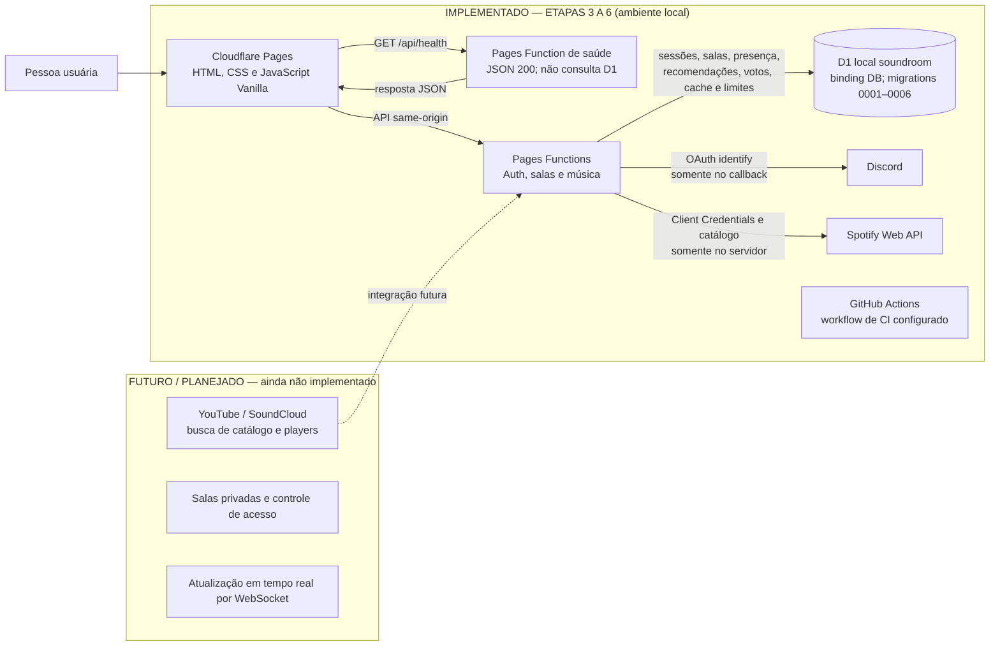
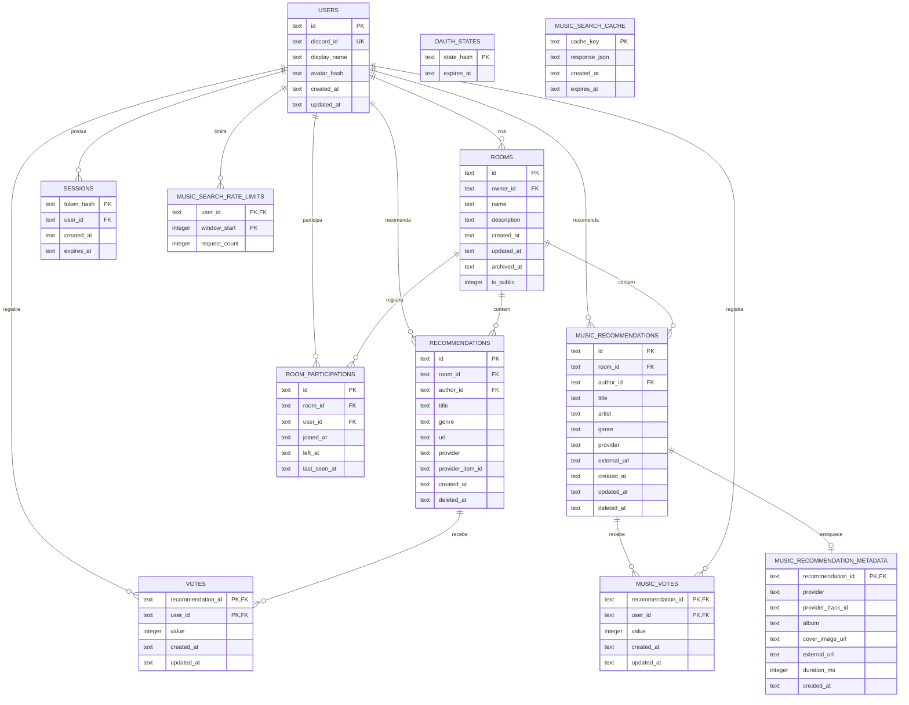

# SoundRoom — Arquitetura e planejamento

**Etapa atual:** 7.5 — Preparação para produção (local/documental)

**Chave acadêmica:** `P26-2C-E152-ECDE-2C2E-90FE`

**Status:** Etapa 7.4 ampliou testes locais de OAuth/Spotify e validou a interface com mocks. A Etapa 7.5 documenta requisitos de configuração, publicação e recuperação. Nenhuma integração externa ao vivo foi validada. `wrangler.jsonc` contém IDs de D1 para Preview e Production, mas sua validade e associação aos ambientes não foram verificadas.

## 1. Objetivo e escopo

O SoundRoom será uma aplicação web social para descobrir e compartilhar músicas adequadas a sessões de estudo e programação. Pessoas poderão consultar salas públicas, recomendar faixas de YouTube, Spotify ou SoundCloud e votar nas recomendações. A pontuação determinará a ordem da lista e as três primeiras posições serão destacadas.

### Estado das funcionalidades

| Requisito | Responsabilidade principal |
|---|---|
| Login com Discord | Pages Functions e sessão persistida no D1 |
| Criar, listar, consultar, entrar, sair e encerrar salas públicas | Implementado na Etapa 5 com Pages Functions e D1 |
| Participantes, avatar e presença | Implementado; presença HTTP a cada 30 segundos, online por 90 segundos |
| Recomendar título, artista e gênero | Implementado na Etapa 5; recomendação manual preservada |
| Busca de catálogo Spotify | Endpoint legado/opcional implementado; requer credenciais e não é usado pela interface |
| Recomendação por link externo | Implementada para YouTube, Spotify e SoundCloud, sem credenciais dessas plataformas |
| Votos positivos/negativos, alteração e remoção | Implementado na Etapa 5, com unicidade em D1 |
| Ordenação e destaque das três primeiras | Implementado por score calculado dos votos reais |
| Autor e avatar | Implementado com dados do usuário autenticado obtidos no servidor |
| Histórico de participações, recomendações removidas e salas encerradas | Implementado sem exclusão física |

### Premissas de produto

Regras implementadas nesta etapa:

1. Salas são públicas; login é necessário para criar, participar, recomendar e votar.
2. O criador encerra sua própria sala. O encerramento é lógico e fecha participações ativas.
3. Participantes ativos podem ter um único voto por recomendação, inclusive na própria recomendação; podem alterar ou remover o próprio voto.
4. A pontuação é votos positivos menos negativos; desempates usam data de criação e ID determinísticos.
5. Perfil, autor e identidade vêm da sessão validada no servidor. O endpoint legado de busca Spotify usa Client Credentials somente no servidor; nenhum token vai ao navegador ou ao D1.
6. Recomendações removidas, salas encerradas e participações anteriores permanecem no histórico.

**FUTURO / PLANEJADO:** salas privadas, edição de sala, busca de catálogo em YouTube/SoundCloud, WebSocket e reprodução incorporada. Recomendações por links externos dessas plataformas já são suportadas.

## 2. Arquitetura geral

Aplicação de página única simples, sem framework: HTML5 e CSS3 são publicados como arquivos estáticos; JavaScript Vanilla usa `fetch()` para chamar a API no mesmo domínio. Cloudflare Pages Functions executa a lógica de backend e acessa o Cloudflare D1 por meio do binding `DB`.

Não há servidor próprio nem chamada direta do navegador ao D1. O fluxo principal de recomendações não chama APIs de música; o endpoint Spotify opcional/legado é acessado somente pelo servidor.

O diagrama separa o que já funciona nesta etapa do desenho planejado. Linhas contínuas identificam integrações implementadas localmente; linhas tracejadas e itens no grupo **FUTURO / PLANEJADO** ainda não são funcionalidades disponíveis.



Na Etapa 3, a página estática e a Function de saúde respondem localmente; a saúde não verifica D1. As etapas 4 e 5 adicionam OAuth/sessões e operações de sala no D1 local `DB`. A Etapa 6 adicionou o endpoint legado de busca Spotify no servidor. O fluxo principal atual recomenda conteúdo por link HTTPS validado, sem consultar catálogo externo. O OAuth do Discord e a busca Spotify ao vivo exigem credenciais externas.

**FUTURO / PLANEJADO:** busca de catálogo em YouTube/SoundCloud, salas privadas, WebSocket e reprodução incorporada. Links externos validados de YouTube, Spotify e SoundCloud já podem ser recomendados; o SoundRoom não reproduz nem baixa áudio.

### Responsabilidades por camada

- **Frontend (`public/`)**: renderizar salas, músicas, placar, formulários e estado de autenticação; validar para melhorar a experiência, sem confiar nessa validação para segurança.
- **Pages Functions (`functions/`)**: autenticação, autorização, validação definitiva, regras de negócio, consultas SQL parametrizadas e respostas JSON.
- **Provider Spotify (`functions/_shared/music/providers/`)**: Client Credentials, cache do token no isolate, timeout, normalização do catálogo e tratamento limitado de `401`/`429`.
- **Serviço de busca (`functions/_shared/music/`)**: valida sessão, aplica limite de buscas em D1, cacheia resultados por dois minutos e retorna metadados normalizados.
- **D1 (`migrations/`)**: persistência relacional, integridade referencial, unicidade de votos e índices.
- **Discord**: autenticar a pessoa e fornecer seu identificador, nome e avatar; não é a base de usuários do SoundRoom.
- **GitHub**: histórico, revisão por pull request, verificações automatizadas e integração com publicação no Cloudflare.

## 3. Estrutura de diretórios

Estrutura prevista, com os arquivos já implementados destacados pela própria árvore:

```text
soundroom/
├── public/
│   ├── index.html
│   └── assets/
│       ├── css/
│       │   └── styles.css
│       └── js/
│           └── app.js
├── functions/
│   ├── _shared/
│   │   ├── auth.js
│   │   ├── rooms.js
│   │   └── music/
│   │       ├── search.js
│   │       └── providers/spotify.js
│   └── api/
│       ├── health.js
│       ├── auth/
│           ├── callback.js
│           ├── discord.js
│           ├── logout.js
│           └── me.js
│       ├── rooms.js
│       ├── rooms/[roomId].js
│       ├── rooms/[roomId]/
│       │   ├── close.js
│       │   ├── history.js
│       │   ├── join.js
│       │   ├── leave.js
│       │   ├── participants.js
│       │   ├── presence.js
│       │   └── recommendations.js
│       ├── recommendations/[recommendationId].js
│       ├── recommendations/[recommendationId]/vote.js
│       └── music/search.js
├── migrations/
│   ├── 0001_init.sql
│   └── soundroom/
│       ├── 0001_initial_schema.sql
│       ├── 0002_music_rooms.sql
│       ├── 0003_participant_presence.sql
│       ├── 0004_spotify_catalog.sql
│       ├── 0005_external_music_links.sql
│       └── 0006_allow_self_votes.sql
├── tests/
│   ├── api/
│   │   ├── auth.test.js
│   │   ├── health.test.js
│   │   ├── spotify.test.js
│   │   └── run-tests.ps1
│   ├── helpers/
│   │   └── local-pages.mjs
│   ├── database/
│   │   ├── migrations.test.mjs
│   │   └── run-tests.ps1
│   └── integration/
│       ├── rooms-local.test.mjs
│       └── run-local.ps1
├── .github/
│   ├── copilot-instructions.md
│   ├── agents/
│   │   ├── arquiteto-desenvolvedor.agent.md
│   │   ├── seguranca-banco.agent.md
│   │   └── qa-validacao.agent.md
│   ├── skills/
│   │   ├── frontend-vanilla/SKILL.md
│   │   ├── pages-functions/SKILL.md
│   │   ├── d1-migrations/SKILL.md
│   │   └── qa-cloudflare/SKILL.md
│   └── workflows/
│       └── ci.yml
├── .dev.vars.example
├── .gitignore
├── ARQUITETURA.md
├── package-lock.json
├── package.json
└── wrangler.jsonc
```

O roteamento de Pages Functions deriva dos nomes de arquivos, incluindo rotas dinâmicas como `[roomId]/join.js` e `[recommendationId]/vote.js`. As rotas listadas na seção 4 já existem; somente as capacidades marcadas como futuras não estão implementadas.

## 4. Comunicação e formato da API

Todas as rotas da aplicação ficam sob `/api` e usam o mesmo domínio da página. O frontend chama `fetch('/api/...')`; respostas de sucesso e erro são JSON, exceto os redirecionamentos de OAuth. Requisições de alteração usam JSON e cookie de sessão. A API deve responder com códigos HTTP apropriados e mensagens de erro que não exponham detalhes internos.

Exemplo de envelope de erro:

```json
{ "error": { "code": "VALIDATION_ERROR", "message": "Verifique os dados enviados." } }
```

### Endpoints implementados

| Método e rota | Acesso | Finalidade |
|---|---|---|
| `GET /api/health` | Público | Verifica que a Pages Function está respondendo; não consulta D1 |
| `GET /api/auth/discord` | Público | Inicia OAuth2 `identify` |
| `GET /api/auth/callback` | Navegador | Valida state, troca código no servidor e cria sessão |
| `GET /api/auth/me` | Público | Retorna usuário autenticado ou `null` |
| `POST /api/auth/logout` | Mesma origem | Revoga sessão |
| `GET /api/rooms?limit&offset` | Público | Lista salas públicas ativas com contagens e paginação |
| `POST /api/rooms` | Autenticado | Cria sala pública e participação inicial |
| `GET /api/rooms/:roomId` | Público | Consulta sala ativa ou encerrada |
| `POST /api/rooms/:roomId/join` | Autenticado | Entra em sala ativa |
| `POST /api/rooms/:roomId/leave` | Participante | Registra saída mantendo histórico |
| `POST /api/rooms/:roomId/presence` | Participante | Atualiza heartbeat de presença |
| `POST /api/rooms/:roomId/close` | Criador | Encerra sala e presenças ativas |
| `GET /api/rooms/:roomId/participants` | Público | Lista participações atuais com presença online/offline |
| `GET /api/rooms/:roomId/recommendations` | Público | Lista recomendações ativas por pontuação |
| `POST /api/rooms/:roomId/recommendations` | Participante ativo | Cria recomendação manual com título, artista, gênero e link HTTPS validado |
| `DELETE /api/recommendations/:recommendationId` | Autor ou criador, sala aberta | Remove logicamente recomendação e preserva votos no histórico |
| `POST /api/recommendations/:recommendationId/vote` | Participante | Cria ou altera voto `1` ou `-1` |
| `DELETE /api/recommendations/:recommendationId/vote` | Participante | Remove o próprio voto |
| `GET /api/rooms/:roomId/history?limit&offset` | Público | Lista participações e recomendações preservadas |
| `GET /api/music/search?q=...&limit=10&offset=0` | Autenticado | Pesquisa faixas do catálogo Spotify |

As listas usam paginação no servidor, limite padrão 20, máximo 50 e offset máximo 10000. A listagem de recomendações retorna `score`, `userVote` e autor público. A ordenação de score é determinística e os três primeiros itens recebem destaque no frontend. Para o placar, a API inclui `pagination.rankingVersion`; páginas seguintes devem enviar essa versão e recebem `409 RANKING_CHANGED` se o estado usado para ordenar mudou, para que o cliente reinicie pelo topo. O marcador é calculado com contagens, saldo e timestamps atuais, não é um snapshot histórico do D1; em mudanças concorrentes excepcionalmente coincidentes no mesmo milissegundo, não há garantia de consistência absoluta. Mutações verificam sessão, origem e, quando há corpo, tipo e tamanho do JSON.

### Validação e proteção das rotas

- Validar tipos, tamanhos e campos aceitos no servidor; rejeitar campos desconhecidos quando adequado.
- Recomendações usam links externos: o servidor aceita somente HTTPS nos hosts e formatos permitidos de YouTube, Spotify e SoundCloud. O endpoint opcional de busca Spotify valida e normaliza os dados do catálogo, mas não é usado pela interface nem pelo fluxo principal de recomendações.
- Usar consultas D1 parametrizadas. Não construir SQL concatenando valores recebidos.
- Aplicar autorização em cada operação: login não implica permissão para editar qualquer sala ou recomendação.
- Em alterações autenticadas, verificar `Origin` com a origem oficial configurada, exigir JSON e usar cookie `SameSite=Lax`; não habilitar CORS amplo.
- Recomendações de salas abertas são visíveis também a não participantes. A criação e os votos continuam restritos a participantes ativos; o autor ou criador pode remover enquanto a sala estiver aberta, mesmo após sair. A API valida a autorização e o estado da sala independentemente dos controles da interface.
- Limitar tamanho de corpo, validar identificadores e tratar falhas sem retornar stack traces.
- Buscas autenticadas têm limite persistente por usuário (12 por janela fixa de 60 s); Spotify também aplica quotas por app, variável por modo. O cache D1 de resultados dura 120 s; o token de aplicação fica somente em memória do isolate.

O endpoint legado de busca Spotify recebe somente chamadas HTTPS a endpoints oficiais; consultas são codificadas com `URLSearchParams`, e IDs são validados antes de interpolar em um caminho fixo. 429 não dispara retry automático; um 401 permite uma única renovação e repetição. Timeout de chamadas externas é de seis segundos.

## 5. Spotify Web API — endpoint legado/opcional

### Fluxo atual

1. A pessoa autenticada pode consultar `GET /api/music/search?q=...`; a rota valida sessão e parâmetros, aplica rate limiting no D1 e consulta o cache.
2. Em cache miss, o provider solicita Client Credentials a `accounts.spotify.com`, mantém o token somente no isolate do servidor e consulta `api.spotify.com/v1/search`.
3. O provider valida e normaliza os resultados do catálogo. Resultados válidos são cacheados por 120 segundos no D1; a resposta não contém token. Cache hits também contam para o limite de 12 buscas por usuário em janela fixa de 60 segundos.
4. Essa busca não é chamada pela interface e não seleciona nem cria recomendações. O fluxo atual de recomendação recebe título, artista, gênero e um link HTTPS validado de YouTube, Spotify ou SoundCloud.

O provider fica isolado em `functions/_shared/music/providers/spotify.js`; cache e busca ficam em `functions/_shared/music/search.js`. A interface e a criação de recomendações não dependem desse provider. Busca de catálogo em outras plataformas continua planejada.

**Configuração local:** `SPOTIFY_CLIENT_ID` e `SPOTIFY_CLIENT_SECRET` próprios em `.dev.vars` só são necessários para usar o endpoint opcional de busca. Recomendar links externos não exige essas credenciais. Em produção, Client ID é variável de Pages e Client Secret é secret. Nunca enviar segredo/token ao navegador ou persistir token no D1.

**Quota e limitações consultadas (novembro de 2026):** Client Credentials acessa endpoints sem dados de usuário. A documentação informa que apps em development mode exigem Spotify Premium do proprietário e permitem no máximo cinco usuários Spotify na allowlist. Quota e rate limit variam por modo e podem mudar; uma resposta Spotify `429` é devolvida como `503` neutro com `Retry-After`, sem retry automático. Uma resposta `401` permite uma renovação e repetição, no máximo. A chamada real não foi validada sem credenciais.

Fontes: [Client Credentials](https://developer.spotify.com/documentation/web-api/tutorials/client-credentials-flow), [Search](https://developer.spotify.com/documentation/web-api/reference/search), [Rate Limits](https://developer.spotify.com/documentation/web-api/concepts/rate-limits), [Quota Modes](https://developer.spotify.com/documentation/web-api/concepts/quota-modes), [Developer Policy](https://developer.spotify.com/policy).

## 6. Autenticação Discord OAuth2 — implementada na Etapa 4

Fluxo implementado:

1. O navegador abre `GET /api/auth/discord`.
2. A Function gera um `state` aleatório de 32 bytes, guarda somente seu SHA-256 em `oauth_states` com expiração e define um cookie de correlação `HttpOnly; SameSite=Lax; Path=/api/auth`.
3. A Function redireciona ao Discord solicitando somente o escopo `identify`.
4. O Discord retorna ao `GET /api/auth/callback` configurado com `code` e `state`.
5. A Function compara os estados do retorno e do cookie e consome o registro válido no D1 com operação atômica; estados ausentes, inválidos, expirados ou reutilizados são rejeitados.
6. A Function troca o código e consulta o perfil no servidor. O segredo não sai do servidor; o token temporário do Discord não é persistido. O usuário é atualizado/inserido por seu Discord ID.
7. A Function gera uma sessão aleatória, armazena somente o hash SHA-256 em `sessions` com expiração e devolve o token apenas em cookie `HttpOnly; SameSite=Lax; Path=/` (com `Secure` em HTTPS).
8. `GET /api/auth/me` valida o hash do cookie no D1. `POST /api/auth/logout` exige `Origin` igual a `APP_URL`, revoga a sessão no D1 e expira o cookie.

O cookie de sessão nunca é acessível ao JavaScript. O navegador não guarda credenciais em `localStorage` ou `sessionStorage`. Em produção, cookies devem ser `Secure`; desenvolvimento local deve usar o modo local do Wrangler e configuração apropriada para localhost. Sessões e estados expirados precisam de política de limpeza.

**Configuração local:** copie `.dev.vars.example` para `.dev.vars`, informe Client ID e Secret obtidos da sua aplicação e mantenha `APP_URL` e `DISCORD_REDIRECT_URI` correspondentes ao endereço local do Wrangler. No Discord Developer Portal, registre `http://127.0.0.1:8788/api/auth/callback` como Redirect URI local. Reinicie o `npm run dev` após ajustar variáveis.

**Configuração de produção (documentada, não executada):** cadastrar `APP_URL`, `DISCORD_REDIRECT_URI`, `DISCORD_CLIENT_ID`, `OAUTH_STATE_TTL_SECONDS` e `SESSION_TTL_SECONDS` nas configurações do projeto Pages; cadastrar `DISCORD_CLIENT_SECRET` como secret. A Redirect URI deve ser a URL HTTPS pública exata terminada em `/api/auth/callback`, também registrada no portal Discord. Nenhum valor de credencial foi inventado; os `database_id` presentes em `wrangler.jsonc` não foram verificados. Não foi feito deploy nem migration remota nesta etapa.

## 7. Modelo D1

As seis migrations do SoundRoom em `migrations/soundroom/` são aplicadas em ordem numérica. `migrations/0001_init.sql` é a migration original do template do professor: ela permanece em seu caminho e não integra a sequência do SoundRoom. `0001_initial_schema.sql` cria o esquema base, incluindo as tabelas legadas `recommendations` e `votes`. `0002_music_rooms.sql` adiciona visibilidade pública, participações, recomendações musicais e votos. `0003_participant_presence.sql` adiciona `last_seen_at` para heartbeat. `0004_spotify_catalog.sql` adiciona metadados Spotify, cache e limite de buscas. `0005_external_music_links.sql` adiciona provedor e URL externa às recomendações musicais e preenche esses campos a partir dos metadados existentes. `0006_allow_self_votes.sql` atualiza os triggers para permitir voto próprio por participante ativo, sem remover as verificações de participação, sala aberta e recomendação ativa. Datas persistidas são UTC ISO 8601 com milissegundos (`YYYY-MM-DDTHH:mm:ss.SSSZ`).

### Entidades e relacionamentos



### Restrições e índices

- `users.discord_id` é único; o identificador interno é independente do nome mutável no Discord.
- As tabelas `recommendations` e `votes` pertencem ao esquema legado da Etapa 2; as rotas atuais usam `music_recommendations` e `music_votes`, que não exigem URL ou provedor.
- `rooms.owner_id`, `recommendations.room_id`, `recommendations.author_id`, `votes.user_id` e `votes.recommendation_id` são chaves estrangeiras.
- A migration `0001` mantém o esquema legado de `recommendations` e `votes`; o fluxo atual usa `music_recommendations` e `music_votes`.
- `recommendations.author_id` não pode ser alterado após a criação, preservando a integridade dos votos existentes.
- `votes.value` e `music_votes.value` aceitam somente `-1` ou `1`; a chave primária composta `(recommendation_id, user_id)` impede votos duplicados da mesma pessoa por recomendação. A regra legada da tabela `votes` permanece na migration `0001`; a migration `0006` permite voto próprio na tabela atual `music_votes` enquanto o autor for participante ativo.
- A remoção de recomendação é lógica (`deleted_at`): somente autor ou criador da sala podem remover enquanto ela estiver aberta. Após o arquivamento (`archived_at`), recomendações ficam imutáveis. Registros e votos são preservados no histórico; chaves estrangeiras usam `ON DELETE RESTRICT`.
- `rooms.is_public` é booleano restrito a 0/1 e, na Etapa 5, novas salas são públicas. Uma participação ativa única é garantida por índice parcial em `(room_id, user_id)`; saída e atividade são preservadas em `left_at` e `last_seen_at`.
- `music_recommendations` limita título, artista e gêneros; a migration `0005` adiciona `provider` e `external_url`, que podem permanecer nulos para registros legados sem metadados Spotify. Triggers D1 reforçam participação ativa, sala aberta, autor imutável, elegibilidade do voto e preservação do histórico.
- `music_recommendation_metadata` preserva metadados Spotify legados validados pelo servidor; a interface atual não consulta esse catálogo ao criar recomendações. A migration `0005` copia os links existentes para `music_recommendations`; novas recomendações armazenam provedor e URL nessa tabela principal.
- `music_search_cache` usa chave SHA-256 e expiração; `music_search_rate_limits` tem chave composta por usuário e início da janela. Ambas são criadas pela migration `0004_spotify_catalog.sql`; token Spotify não é persistido. Essa busca é opcional/legada e não participa da criação de recomendações na interface atual.
- Salas encerradas usam `archived_at`; recomendações removidas usam `deleted_at`. Triggers encerram participações abertas e impedem remoção física de histórico; chaves estrangeiras usam `ON DELETE RESTRICT`.
- Índices apoiam lista/histórico de participações, recomendações por sala, votos por recomendação e listagens de salas ativas. O score é calculado como `SUM(music_votes.value)` em consulta agregada, sem coluna duplicada.
- As migrations são aplicadas e testadas somente em D1 local nesta etapa; nenhuma migration remota foi executada.

## 8. Agentes, harness e skills

### Responsabilidades dos três agentes

| Agente | Responsabilidades | Limites e entregáveis |
|---|---|---|
| Desenvolvedor e arquiteto | Manter contratos entre interface/API; implementar HTML, CSS, JS Vanilla e Functions; documentar decisões e abrir PRs pequenos. | Não altera regras de autenticação ou esquema sem revisão do agente de segurança; cada PR inclui critérios de aceite e testes relevantes. |
| Segurança e banco de dados | Revisar OAuth, cookies, autorização, validação, SQL, migrações, índices e retenção; verificar que segredos não entram no Git. | Atua como revisor/aprovador dessas áreas; documenta riscos e bloqueia publicação se houver exposição de credenciais ou falha crítica. |
| Testes e validação (QA) | Converter requisitos em casos de teste; testar rotas, permissões, migrations, interface e fluxos de erro; executar checklist de preview e produção. | Não altera a implementação para mascarar falhas; registra passos reproduzíveis e evidências no PR. |

Os agentes são papéis de trabalho e revisão, não serviços autônomos de produção. O responsável humano mantém a decisão final, especialmente sobre premissas marcadas para confirmação.

### Harness de desenvolvimento

Harness aqui significa o conjunto que torna o trabalho repetível e verificável: instruções versionadas (`.github/copilot-instructions.md`), definições dos três agentes, skills locais curtos, scripts de desenvolvimento/teste, configuração Wrangler, migrations versionadas, testes automatizados e GitHub Actions. Cada mudança passa por branch e PR, revisão de segurança para auth/D1, CI verde e publicação controlada.

### Skills versionados no repositório

Serão instruções reutilizáveis específicas do projeto, não dependências de runtime:

1. **`frontend-vanilla`**: acessibilidade HTML, CSS responsivo, `fetch`, renderização segura com `textContent`, sem frameworks e sem armazenamento de autenticação no navegador.
2. **`pages-functions`**: roteamento Pages, middleware, bindings, validação, códigos HTTP e erros JSON.
3. **`d1-migrations`**: esquema SQLite/D1, chaves/índices, migrações aditivas, consultas parametrizadas e execução local/produção.
4. **`qa-cloudflare`**: testes de Functions e D1 local, critérios de aceite, smoke tests e checklist de publicação.

As definições dos três agentes estão versionadas em `.github/agents/` e os quatro skills estão versionados em `.github/skills/`. O harness usado no projeto é o GitHub Copilot Agent (arquivos `.agent.md` e `copilot-instructions.md`), apoiado por Node.js `node:test`, Wrangler, Cloudflare Pages Functions/D1 local e GitHub Actions. Os arquivos registram os papéis, instruções e procedimentos reutilizáveis; a existência desses arquivos, isoladamente, não comprova execução autônoma de cada agente. O histórico de uso e as evidências de execução devem ser registrados pelo responsável no processo de desenvolvimento/PR.

## 9. Testes e publicação

### Estratégia de testes

1. **Banco**: aplicar as migrations em D1 local e verificar chaves estrangeiras, votos únicos, histórico, presença, arquivamento e agregação de pontuação.
2. **API unitária**: testar validação, métodos HTTP, sessão, início/callback OAuth simulado, state de uso único, cookies e erros sem credenciais externas.
3. **Integração Pages + D1 local**: percorrer salas, membros, heartbeat, recomendações, votação, histórico, sessão e logout no runtime local.
4. **Frontend**: validar formulários, navegação por teclado, estados de carregamento/erro/vazio, renderização de texto e destaque das três primeiras recomendações.
5. **OAuth ao vivo**: depende de credenciais reais e Redirect URI cadastrada no Discord; não foi validado.
6. **CI e publicação futura**: executar testes em PR; preview, migrations e deploy de produção exigem aceite e autorização explícitos.

O Wrangler e o runner de testes nativo do Node.js estão configurados no projeto. `npm test` executa unitários, D1 isolado e integração Pages + D1 local temporária. O OAuth unitário percorre início e callback com D1/fetch simulados, incluindo estado válido, inválido e repetido, negação, falhas de token/perfil, criação de sessão e atributos de cookies. O provider Spotify usa `fetch` mockado para cache local do token, renovação após `401`, limite de retry e `429`; a integração local cobre cache D1, rate limit e chamadas simultâneas de entrada/voto em D1 local. A interface foi exercitada no navegador com APIs simuladas durante a etapa anterior, mas essa verificação não está automatizada/versionada: os testes de frontend em `npm test` cobrem os helpers de paginação e as políticas puras de recomendação, não a DOM ou os fluxos visuais. Nenhum teste valida OAuth Discord ou Spotify ao vivo, e nenhum banco de produção foi acessado. Os testes descartam seus bancos locais temporários.

### Ambientes e configuração externa

- **GitHub**: repositório, branches protegidas conforme disponibilidade, pull requests e GitHub Actions.
- **Cloudflare**: local usa o binding D1 `DB` e nome `soundroom`; `wrangler.jsonc` aponta para `public/` e `migrations/` e declara ambientes Preview/Production com `database_id`. A validade e a associação desses IDs aos bancos reais ainda precisam ser confirmadas antes de deploy; usar bancos separados e nunca inserir IDs fictícios.
- **Discord Developer Portal**: aplicação OAuth2, Client ID, Client Secret e Redirect URI de cada ambiente.
- **Domínio/origem**: definir domínio oficial antes de configurar cookies `Secure`, checagem de `Origin` e Redirect URI de produção.
- **Variáveis de autenticação**: `DISCORD_CLIENT_ID`, `DISCORD_CLIENT_SECRET`, `DISCORD_REDIRECT_URI`, `APP_URL`, `OAUTH_STATE_TTL_SECONDS` e `SESSION_TTL_SECONDS`; `DB` é o binding D1. O segredo deve ser cadastrado como secret de Pages. Os valores reais serão obtidos do painel/CLI, não presumidos neste documento.
- **Dependências de execução**: nenhuma biblioteca de frontend; APIs nativas do navegador e Web APIs disponíveis no runtime Cloudflare.
- **Ferramentas de desenvolvimento**: Node.js/npm e Wrangler CLI (dependência de desenvolvimento); testes unitários com `node:test`, D1 local com PowerShell e integração Pages/D1 com Node.js.

Não incluir `.dev.vars` com valores reais no Git. Manter apenas `.dev.vars.example` sem segredos e ignorar arquivos locais com credenciais.

### Critérios pendentes para Pages e D1 remotos

- Definir o projeto Pages, domínio e origens HTTPS; usar `public/` como output estático e nenhum build command (ou `exit 0` quando a configuração de Pages exigir um comando).
- Confirmar que o binding `DB` de Preview e Production aponta para bancos distintos. O nome `soundroom` no Wrangler não identifica por si só a conta nem o banco remoto; cada `database_id` deve corresponder ao recurso real daquele ambiente.
- Configurar por ambiente `APP_URL`, `DISCORD_REDIRECT_URI`, `DISCORD_CLIENT_ID`, `OAUTH_STATE_TTL_SECONDS`, `SESSION_TTL_SECONDS` e `SPOTIFY_CLIENT_ID`; cadastrar `DISCORD_CLIENT_SECRET` e `SPOTIFY_CLIENT_SECRET` exclusivamente como secrets. Registrar a Redirect URI HTTPS exata no Discord Developer Portal; Spotify Client Credentials não usa Redirect URI de usuário.
- Antes da aplicação remota, fazer backup aprovado, confirmar banco e histórico de migrations, comparar hashes e testar a versão compatível localmente; aplicar migrations somente com autorização explícita e verificar o schema/resultados no ambiente autorizado.
- A documentação vigente do [D1 `batch()`](https://developers.cloudflare.com/d1/worker-api/d1-database/#batch) afirma execução sequencial e rollback da sequência se um statement falhar. É uma garantia documentada do serviço, não evidência de operação remota deste projeto. O teste local cobre corridas de entrada e votos duplicados, mas não representa carga nem concorrência do D1 remoto. Chaves únicas, constraints, triggers e escrita condicional protegem invariantes específicas (como participação ativa e voto único), mas não comprovam concorrência fim a fim sob carga.

## 10. Estado e próximos passos

1. **Etapa 1 — Arquitetura**: documentada.
2. **Etapa 2 — Banco D1**: migration criada, preservada e validada exclusivamente em D1 local.
3. **Etapa 3 — Esqueleto e ambiente local**: página inicial Vanilla, Pages Function de saúde, scripts npm, testes e configuração local; esta etapa não implementa OAuth nem rotas completas de salas.
4. **Etapa 4 — Autenticação Discord e sessões**: código local implementado; configurar credenciais e Redirect URI para validar o fluxo ao vivo.
5. **Etapa 5 — Salas musicais**: API, D1 local, UI, recomendações sem mídia, votação, presença e histórico implementados e cobertos pela suíte local.
6. **Etapa 6 — Spotify**: provider e rotas implementados; credenciais e chamadas reais permanecem sem validação ao vivo.
7. **Etapa 7 — Auditoria**: workspace e requisitos de produção auditados; publicação não autorizada nem executada.
8. **Etapa 7.1 — Integridade**: ausência de `public/` e `tests/` confirmada no workspace; causa histórica não comprovada.
9. **Etapa 7.3 — Recuperação**: frontend e testes locais reconstruídos; migrations preservadas por hash; comportamento em produção continua pendente.
10. **Etapa 7.4 — Fechamento de pendências**: cobertura local do callback OAuth e cache/erros Spotify ampliada; fluxos de recomendação exercitados na interface com APIs simuladas; configuração remota, credenciais e integrações ao vivo permanecem pendentes.
11. **Etapa 7.5 — Preparação para produção**: requisitos de ambiente, D1, migrations, segurança, publicação e rollback documentados em [PRODUCAO.md](./PRODUCAO.md); os IDs presentes na configuração não foram verificados contra recursos remotos.

**Pendências antes de produção:** concluir aceite acadêmico; definir domínio e ambientes; confirmar que os IDs D1 já declarados em `wrangler.jsonc` correspondem a bancos distintos de Preview e Production; configurar credenciais, Redirect URIs e secrets reais; conferir a sequência e os hashes das seis migrations; aprovar backup/rollback e executar publicação somente mediante autorização. A atomicidade de `DB.batch` é descrita pela documentação Cloudflare, mas não testamos o serviço remoto; o teste de concorrência é somente D1 local, e concorrência operacional segue pendente. OAuth e Spotify têm testes de fluxo e provider simulados, sem prova de integrações reais. O histórico por sala conhecida existe; endpoint global para descobrir salas arquivadas não foi implementado porque ainda não há requisito confirmado, e exigiria definir visibilidade, autorização e paginação. Busca de catálogo em YouTube/SoundCloud, WebSocket e salas privadas ficam **FUTURAS / PLANEJADAS**; recomendações por links externos dessas plataformas já são suportadas. Preview, deploy e migrations remotas dependem de autorização explícita.
