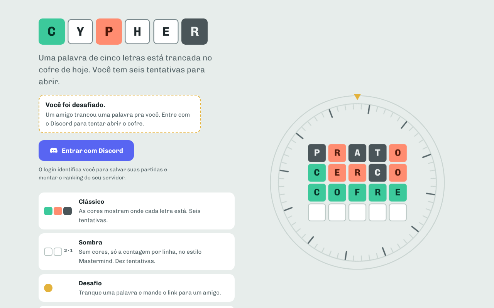
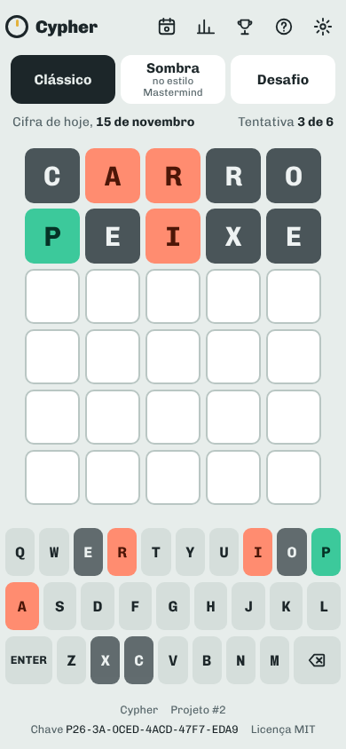
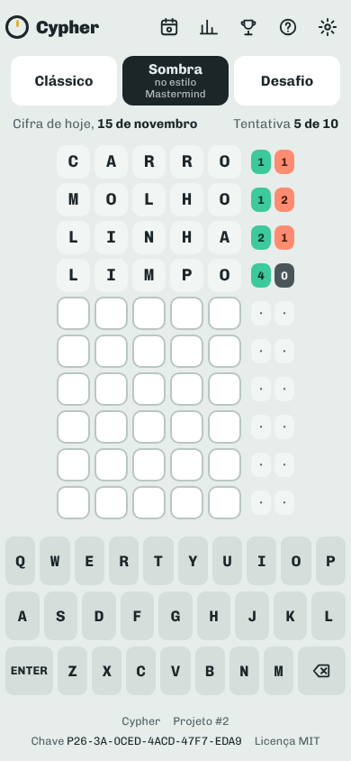
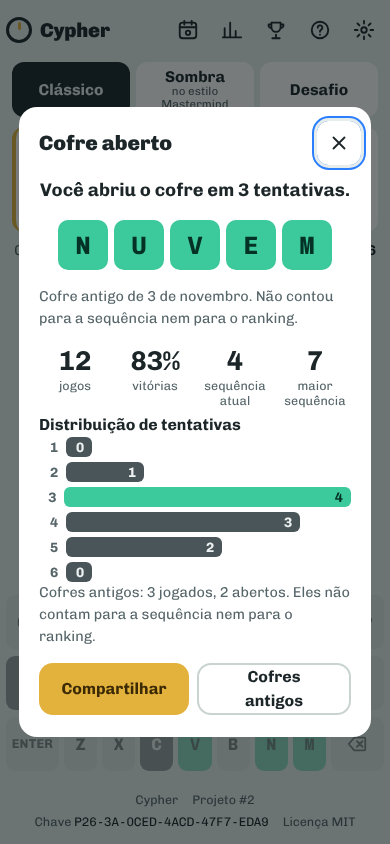
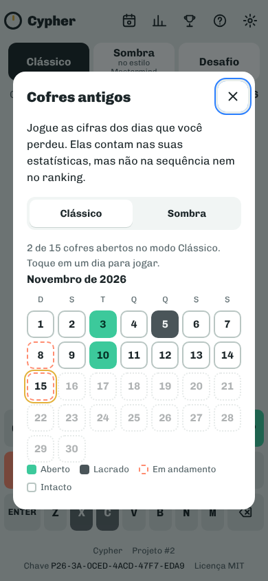
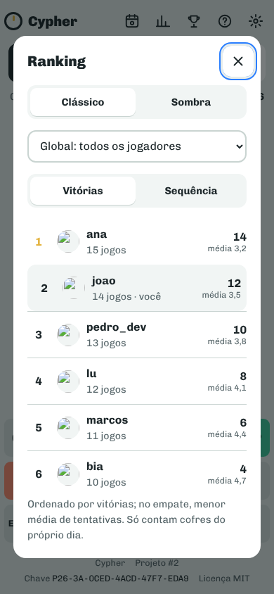
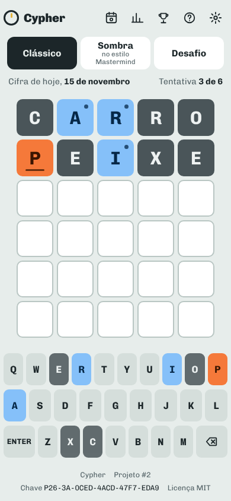

# 🔐 Cypher — quebre a cifra do dia

> Um jogo diário de adivinhar palavras de cinco letras, com cara de cofre. Projeto #2 (Clone do Termo/Wordle Diário).

- **Estudante:** Joao Siedlarczyk
- **Turma:** 3A
- **Chave Única:** `P26-3A-0CED-4ACD-47F7-EDA9`
- **URL_CLOUDFLARE:** https://avalia2026-2-5rz.pages.dev
- **Licença:** MIT

<p align="center">
  
</p>

## O que o Cypher tem de diferente

O Cypher parte do jogo clássico, mas foi pensado como um **cofre**: cada dia tem uma cifra trancada, e cada tentativa é um giro no disco.

| | |
|---|---|
| 🟩 **Clássico** | 5 letras, 6 tentativas. As cores mostram onde cada letra está. |
| 🌑 **Sombra** | No estilo Mastermind: as letras **não** ficam coloridas, só aparece a contagem de quantas estão no lugar certo e quantas estão no lugar errado. 10 tentativas, com uma palavra própria. |
| 🎯 **Desafio** | Você tranca uma palavra e manda o link para um amigo. O link vira um card de prévia no Discord e no LinkedIn. |
| 🗄️ **Cofres antigos** | Perdeu um dia? Todo dia desde o lançamento pode ser jogado. Cada cofre aparece como aberto 🔓, lacrado 🔒, em andamento 🗝️ ou intacto. |
| 🏆 **Ranking do servidor** | Além do ranking global, você vê o ranking só com quem está nos mesmos **servidores do Discord** que você. |
| 📤 **Compartilhar** | Resultado em emoji, pronto para colar no Discord. |
| ♿ **Acessível** | Tema claro e escuro, **modo daltônico** (cores de alto contraste + marcação na peça), teclado físico, leitor de tela e movimento reduzido. |

<p align="center">
  
  
  
</p>
<p align="center">
  
  
  
</p>

## Arquitetura

```
Navegador (HTML5 + CSS3 + JavaScript puro)
   │  só envia o chute e recebe as cores
   ▼
Cloudflare Pages Functions  (functions/ + src/)
   │  login Discord OAuth2 · sorteio secreto · validação de cada chute · estatísticas
   ▼
Cloudflare D1 (SQLite)  (migrations/0001_init.sql)
   users · sessions · user_guilds · daily_words · games · guesses · user_stats · challenges ...
```

- **Frontend (`public/`):** página única em JavaScript puro com ES modules nativos, sem framework e sem build. Grade e teclado são criados por manipulação direta do DOM.
- **Backend (`functions/` + `src/`):** cada Function só valida a entrada e chama a lógica compartilhada em `src/`.
- **Banco (`migrations/`):** 10 tabelas relacionais. As estatísticas (streak, maior streak, distribuição) ficam consolidadas em `user_stats`.
- **Contrato completo da API:** [`docs/contrato-api.md`](docs/contrato-api.md).

## Segurança: como a palavra do dia é protegida

O repositório é público, então a defesa não pode depender de esconder código.

1. **A resposta nunca vai para o navegador.** O cliente envia o chute e recebe só o feedback. A palavra só aparece quando a partida termina.
2. **Não existe calendário de respostas no repositório.** A lista de palavras é pública, mas a ordem é um embaralhamento determinado por um segredo (`WORD_SECRET`) que existe só nas variáveis do Cloudflare. Sem o segredo, não dá para saber a palavra de nenhum dia.
3. **Dias futuros não existem.** O servidor só sorteia um dia quando ele chega (fuso de Brasília) e recusa qualquer data futura com `403`.
4. **Recarregar não reinicia.** Cada tentativa fica gravada no D1, e o limite de tentativas é garantido por chave primária no banco.
5. **Sessão de verdade.** Token aleatório de 32 bytes em cookie `HttpOnly`, com só o hash SHA-256 guardado no banco. Um cookie editado à mão não vira outro usuário. O login OAuth2 usa `state` contra CSRF.
6. **Ranking honesto.** Cofres antigos não contam para streak nem ranking, e o ranking de um servidor só é visível para quem é membro dele.

## Palavras

- **1161 respostas** curadas à mão: palavras comuns, sem plurais nem verbos conjugados. São 580 dias sem repetir, já que cada dia usa uma palavra no Clássico e outra no Sombra.
- **10466 chutes aceitos**, derivados de [`fserb/pt-br`](https://github.com/fserb/pt-br) (licença MIT). Detalhes em [`src/data/FONTES.md`](src/data/FONTES.md).
- Você digita sem acento, e o jogo mostra a palavra acentuada no final.

## Engenharia de agentes

O projeto foi construído com **4 agentes no harness Claude Code**: Arquiteto Serverless, Interface Vanilla, Curador de Palavras e **Teste e Validação**, coordenados por um contrato de API único. Veja [`AGENTS.md`](AGENTS.md), as skills em [`skills/`](skills/) e o relatório de testes em [`tests/RELATORIO-TESTES.md`](tests/RELATORIO-TESTES.md).

## Como rodar localmente

```bash
cd P26-3A-0CED-4ACD-47F7-EDA9
npx wrangler d1 migrations apply DB --local
# crie um arquivo .dev.vars (não versionado) com:
# WORD_SECRET=qualquer-texto-longo
# DISCORD_CLIENT_ID=...
# DISCORD_CLIENT_SECRET=...
npx wrangler pages dev public
```

Testes:

```bash
# unitários (os de API são pulados sem servidor)
node --test

# API contra o servidor local (D1 local limpo)
eval "$(bash tests/preparar-ambiente.sh)"
npx wrangler pages dev public --port 8788 &
node --test tests/api.test.mjs
```

Detalhes e resultados em [`tests/RELATORIO-TESTES.md`](tests/RELATORIO-TESTES.md).

## Publicação (Cloudflare Pages + D1 + Discord)

1. Crie o banco D1 `db-p26-3a-0ced-4acd-47f7-eda9`, cole o `database_id` em `wrangler.jsonc` e aplique `migrations/0001_init.sql`.
2. Cloudflare Pages → Connect to Git → **Root directory:** `P26-3A-0CED-4ACD-47F7-EDA9`, **Build command:** vazio, **Build output directory:** `public`.
3. Secrets do projeto Pages: `DISCORD_CLIENT_ID`, `DISCORD_CLIENT_SECRET` e `WORD_SECRET`.
4. No Discord Developer Portal, adicione o redirect `https://<seu-projeto>.pages.dev/api/auth/discord/callback`.

## Licença

[MIT](LICENSE). As fontes Chivo e Chivo Mono estão sob a SIL Open Font License 1.1 (`public/fonts/OFL.txt`), e a lista de palavras base está sob MIT (`src/data/FONTES.md`).
